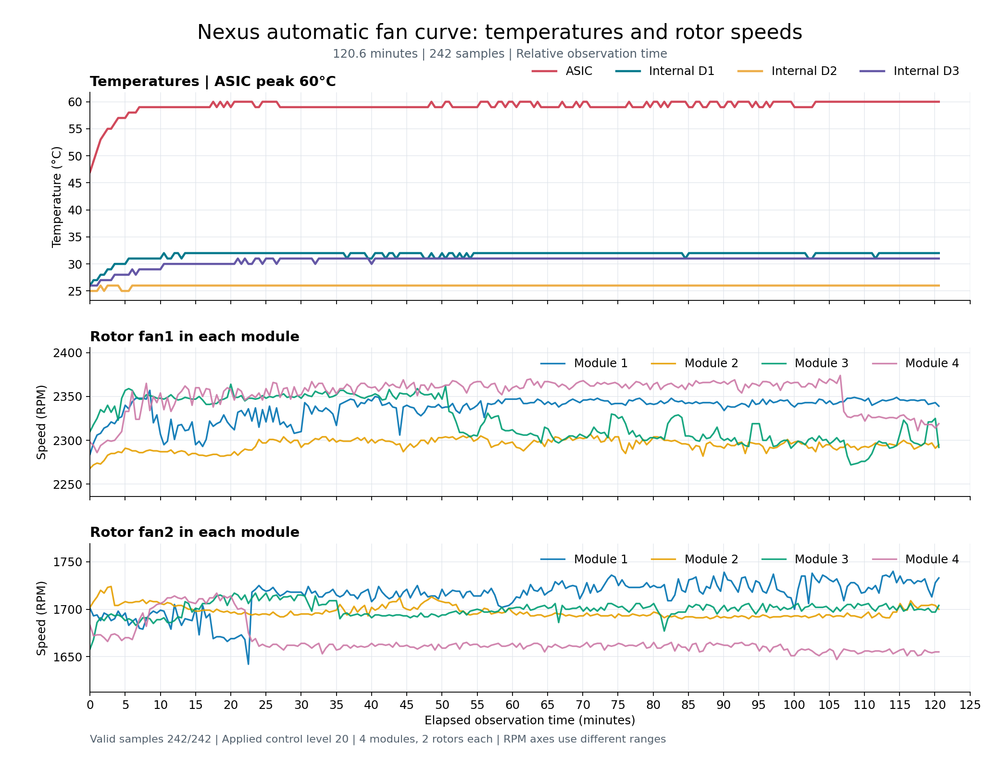

# Nexus Fan Runtime

Lower the minimum of the automatic fan curve on a **Cisco Nexus 3132Q-X running NX-OS 7.0(3)I7(9)** from 50 to 20, with an optional minimum of 30. The original 70 and 99 stages, temperature thresholds, hysteresis, and transition logic remain in place.

This is an experimental, firmware-specific runtime data patch. It changes two validated data words in the running PFM process. It does not modify executable files, boot images, machine instructions, or CMOS. A reboot or PFM restart reloads the original minimum of 50; an optional native NX-OS Scheduler job checks every minute and reapplies the patch after initialization.

At control level 20, a two-hour hardware observation recorded approximately 2,300 RPM for fan1 and 1,700 RPM for fan2. Control levels are device values, not a linear RPM scale. See [validation results](VALIDATION.md) and the [anonymized observation data](examples/two-hour-observation.csv).



## Compatibility and requirements

| Component | Requirement |
| --- | --- |
| Switch | Nexus C3132Q-X / N3K-C3132Q-40GX |
| Fan modules | Four NXA-FAN-30CFM modules, two rotors per module |
| NX-OS | 7.0(3)I7(9), exact PFM hash below |
| Switch runtime | Existing NX-OS Python 2.7 and noninteractive `sudo` access through the admin account |
| Management host | Python 3.8+ and OpenSSH; Python 3.10+ for charts and optional emulation |
| Authentication | Your existing SSH configuration; no passwords or keys bundled |

The tool accepts only `/isan/bin/pfm` with SHA-256:

```text
8f98bf8242954dc64e34b86711883aaf24166c0ec1aba449ace5e2d33a9ddd88
```

It also verifies the card, fan model, dynamic load address, process identity, pointers, curve data, fixed-speed flag, sensor status and thresholds, hardware callback, and driver bounds before writing. Other firmware builds are rejected. Do not reuse these offsets after an upgrade.

This patch is not a Cisco-supported configuration feature. A two-hour observation on one device does not establish suitability for other workloads or environments. Full reboot recovery and hardware operation of the optional 30 stage have not been tested.

## Read-only commands

Use `switch-admin` below as a placeholder for an SSH destination that you configure. Every management command requires an explicit `--host`; the project has no default destination.

```bash
python3 hostctl.py --host switch-admin check
python3 hostctl.py --host switch-admin sample
python3 hostctl.py --host switch-admin scheduler-status
```

`check` reads the process state. `sample` additionally checks the eight chassis rotors, their control levels, RPM, and module health. Neither command applies the patch.

## Deploy and enable automatic reapplication

Run these steps only on a device you administer. Keep configuration backups and console access available. The deployment command saves running/startup configurations and an environment snapshot in a local directory with mode 0700 and files with mode 0600. These files may contain sensitive information and must remain private.

Start with a read-only scheduled job:

```bash
python3 hostctl.py --host switch-admin deploy --check-only --backup-dir ./local-evidence/predeploy
python3 hostctl.py --host switch-admin scheduler-status
```

Wait for the scheduled `check` job to report `Success (0)`. Then enable the patch:

```bash
python3 hostctl.py --host switch-admin activate-scheduler --minimum 20
# Wait for the next scheduled execution, then check real rotor speeds.
python3 hostctl.py --host switch-admin sample
python3 hostctl.py --host switch-admin scheduler-status
python3 hostctl.py --host switch-admin save-config
```

The resulting schedule is equivalent to:

```text
feature scheduler
scheduler job name nexus-fan20
  python bootflash:/scripts/nexus-fan20.py ensure 20
scheduler schedule name nexus-fan20
  job name nexus-fan20
  time start now repeat 0:0:1
```

The device script is installed at `bootflash:/scripts/nexus-fan20.py`. Names retain `nexus-fan20` for compatibility even when selecting a minimum of 30. NX-OS job-definition parsing consumes following commands, so the management tool configures the feature, job, and schedule in separate CLI sessions. On the tested firmware, `time start now` first ran after about two minutes, then once per minute.

Saving the configuration persists the job and schedule. The script itself resides on bootflash. During startup, checks reject an uninitialized PFM process and retry on the next scheduled run. Configuration persistence was verified; a complete switch reboot was not performed.

`deploy` refuses to overwrite an existing script or backup file. Without `--check-only`, it creates an applying job immediately. The staged procedure above is the tested deployment path.

## How the patch changes physical fan speed

The lowest curve word changes from 50 to the selected minimum. For the first cold transition, the cached fan-zone state is temporarily set to 70. The tool resubmits the existing default `hardware fan-zone 1 raise-speed 0` setting so the original temperature function produces a real 70-to-minimum notification to the driver.

Writing the target into the cache directly would suppress that notification and could change reported values without changing physical RPM. The tool therefore checks actual control values and rotor speeds after applying. An already applied minimum, or an existing hot state of 70 or 99, is left alone. A legacy low state that does not meet all cooling conditions is deferred. Existing manual fan-zone increments are rejected.

## Preserved automatic temperature curve

These transitions were derived from the pinned firmware function and checked by executing its original x86 instructions offline. Temperatures are in degrees Celsius.

| Sensor | Minimum to 70 | 70 to 99 | 99 to 70 | 70 to minimum |
| --- | ---: | ---: | ---: | ---: |
| ASIC | >=96 | >=102 | <=95 | <=89 |
| Internal D1 | >=54 | >=61 | <=54 | <=47 |
| Internal D2 | >=47 | >=55 | <=48 | <=40 |
| Internal D3 | >=51 | >=58 | <=51 | <=44 |

Any sensor can request a higher stage. All sensors must satisfy the cooling conditions before lowering a stage. D3 also retains an original hold counter of approximately ten calculation cycles; its duration in seconds has not been measured. CLI alarm and shutdown thresholds are separate from these fan transitions and are unchanged. High-temperature transitions were not induced on hardware.

## Observe temperatures and thermal balance

```bash
python3 observe.py --host switch-admin --minimum 20 --minutes 60 --output ./local-evidence/hour.jsonl
python3 assess_equilibrium.py --input ./local-evidence/hour.jsonl
```

Observation samples every 30 seconds and reports every five minutes. A management-host monotonic clock measures the duration. Failed samples are recorded as errors, never replaced with old readings. JSONL observations include timestamps and process metadata, so keep them private.

The assessor examines four consecutive five-minute windows covering the latest 20 minutes. All four sensor peaks must stop increasing. Missing samples or intervals longer than 45 seconds make the assessment inconclusive. Optional `--allow-integer-jitter` permits a later peak up to 1 degree above the first window, but rejects any later window mean more than 0.5 degrees higher.

An example operating policy is to observe for one hour, extend to two hours if the last 20 minutes are still warming, and consider a minimum of 30 if balance is still not reached. The assessor is read-only; it does not deploy that policy or change fan speeds automatically.

To select 30, change the Scheduler target first, wait for it to apply, verify physical RPM, then save:

```bash
python3 hostctl.py --host switch-admin activate-scheduler --minimum 30
python3 hostctl.py --host switch-admin sample
python3 hostctl.py --host switch-admin scheduler-status
python3 hostctl.py --host switch-admin save-config
```

Do not apply 30 while leaving the scheduled target at 20: the next job would reapply 20. For observation at 30, also pass `--minimum 30` to `observe.py`.

When moving from an actual 20 state to 30, every rotor must increase RPM by more than 15 percent within the application deadline. The 30-stage RPM ceilings are checked separately. Failure disables the patch and attempts rollback. Lowering from 30 to 20 waits for the original cooling conditions; hot 70/99 states remain available.

## Plot and export

```bash
python3 -m pip install -r requirements-plot.txt
python3 plot_hour.py --input examples/two-hour-observation.csv --output observation.png
# Export local samples with absolute timestamps, process IDs, and error details removed.
python3 plot_hour.py --input ./local-evidence/hour.jsonl --anonymize --csv observation.csv --output observation.png
```

Charts use relative elapsed time. They show four temperature traces and separate RPM traces for all eight rotors. Recorded errors produce missing values rather than invented measurements. The included example retains a real gap between two observation sessions.

## Disable, restore, and remove

```bash
# Write a persistent disable marker and restore the original minimum of 50.
python3 hostctl.py --host switch-admin restore
python3 hostctl.py --host switch-admin sample
# Verify that physical RPM rises; a hot state may remain at 70 or 99.

# Optional: remove this project's job and schedule, then save.
python3 hostctl.py --host switch-admin remove-scheduler
python3 hostctl.py --host switch-admin save-config
```

The marker is `/bootflash/scripts/nexus-fan20.disabled`. Scheduled `ensure` returns `disabled` while it exists, including after reboot. Removing only the Scheduler job does not restore the current process memory; run `restore` first. Reboot reloads the original PFM data, but an enabled Scheduler would reapply the patch.

To re-enable intentionally, keep the requested minimum consistent with the schedule:

```bash
python3 hostctl.py --host switch-admin enable --minimum 20
```

The device-side CLI also accepts `python bootflash:scripts/nexus-fan20.py sample`, `restore`, and `enable 20`.

Before applying, a detached child arms a 30-second rollback. If the parent disappears or fails to acknowledge completion, the child attempts to restore 50 and persist the disable marker. Application errors also take this path. The child cannot run during power loss, and rollback can fail if PFM or the CLI is unavailable; verify actual RPM. Forced parent termination has not been tested on hardware.

## Updating the device script

Test changes offline before updating. Replace the script only when its current SHA-256 matches the expected value:

```bash
python3 hostctl.py --host switch-admin update --expected-sha256 CURRENT_SCRIPT_SHA256
```

The update compiles the new code with the device's Python 2.7 before atomic replacement. It does not directly change PFM memory, but the next scheduled job will use the replacement script.

## Offline validation

```bash
python3 -m unittest discover -s . -p 'test_*.py' -v
python3 -m py_compile nxos_patch.py hostctl.py observe.py assess_equilibrium.py plot_hour.py validate_curve.py
```

Optional instruction emulation requires your own copy of the supported PFM executable:

```bash
python3 -m pip install -r requirements-offline.txt
python3 validate_curve.py --pfm /path/to/your/pfm
python3 validate_curve.py --minimum 30 --pfm /path/to/your/pfm
```

For each target minimum, the emulator checks 1,452 cases across individual sensor values from 0 to 120 degrees and three previous stages, plus a D2 heating/cooling sequence. Logging imports are stubbed; the hardware driver is not emulated. These tests do not exhaust all sensor combinations or prove whole-system behavior.

## License and publication scope

Original project code is released under the [MIT License](LICENSE). No Cisco firmware, extracted executable binaries, credentials, device configurations, internal network addresses, or private deployment history are distributed. Sample data contains only relative time, temperatures, control level, and rotor RPM.
